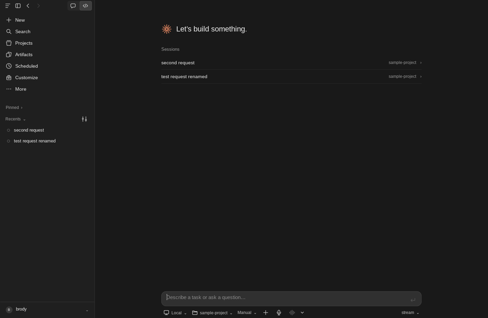
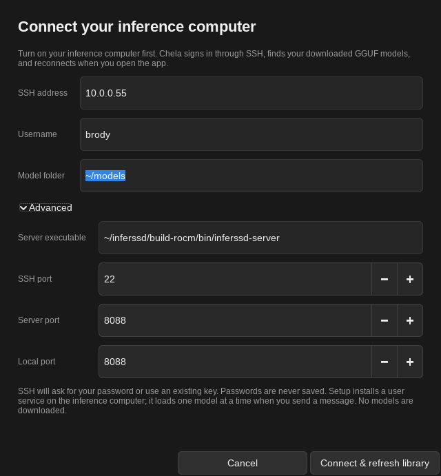

# Chela

A native C desktop for local coding models and agent harnesses. The dark sidebar,
centered composer, project workflow, session history, permission dialogs, and
conversation view follow the supplied Claude desktop references. Chela draws its
own interface with a small C UI library over a thin platform layer: it runs
natively on Wayland with no toolkit and no GLib, and optional Qt 6 and GTK 3 hosts
cover X11 and other desktops. There is no Electron, web frontend, or Python
runtime in the app.

This is an independent implementation, not Anthropic's source code or an official
Claude client. Version 0.1 implements the core coding workflow. It does not yet
have complete feature or pixel parity with Claude Desktop.
See [the parity checklist](docs/parity.md) for verified workflows and remaining gaps.



## Build and run

On Ubuntu 24.04+ or a current Debian-based distribution:

```sh
sudo apt-get install build-essential pkg-config libcurl4-openssl-dev libjson-c-dev \
  libsqlite3-dev libwayland-dev wayland-protocols libxkbcommon-dev libcairo2-dev \
  libfontconfig-dev libfreetype-dev python3 openssh-client libsecret-1-0
./build.sh
./run.sh
```

Started with no arguments, the Code tab opens with no folder and you choose one.
Name a folder to work there by default: `./run.sh /path/to/your/project`.

### UI backends

`build/chela` contains the native Wayland backend and a headless backend for
tests. It picks Wayland when `WAYLAND_DISPLAY` is set. Without a Wayland
compositor it loads a toolkit host instead, Qt first, then GTK, from
`build/backends/` (or `~/.local/lib/chela/` once installed). Build the hosts
you want:

```sh
sudo apt-get install qt6-base-dev   # then: make qt   → build/backends/chela-qt.so
sudo apt-get install libgtk-3-dev   # then: make gtk  → build/backends/chela-gtk.so
```

Choose one explicitly with `--backend=wayland|qt|gtk|headless` or
`CHELA_BACKEND`. The hosts supply the window, input, input methods, clipboard and
native file dialogs; Chela still draws the same interface. `CHELA_DECORATIONS=server`
asks the compositor for its own title bar instead of Chela's.
The contract a backend implements is [`src/ui/platform.h`](src/ui/platform.h);
Cocoa and WinUI 3 hosts are not written yet.

`./build.sh` opens a menu to build, clean build output, rebuild, or exit.
For commands without a menu, use `./build.sh build`, `./build.sh clean`, or
`./build.sh rebuild`. Cleaning removes the generated `build/` directory.
The script works from any directory and builds in parallel; set `JOBS=2` to
limit parallel jobs. Make targets and overrides still work, such as
`./build.sh test` or `./build.sh BUILD=build/custom`.

`./run.sh` launches Chela and builds it first if the executable is missing.
It accepts a project directory or application options, such as `./run.sh --version`.
Use `BUILD=build/custom ./run.sh` to launch a custom build directory.

On a machine with the runtime libraries but no development packages, the optional
`bash scripts/local-deps.sh` downloads headers into the ignored `.deps/` directory
without installing system packages. This fallback targets Debian/Ubuntu x86-64.
The normal build uses `pkg-config` and works with other Linux distributions that
provide the same libraries. Minimum APIs: curl 7.85, json-c 0.14, SQLite 3.24,
wayland-client 1.22, wayland-protocols 1.32, and cairo 1.16; the optional hosts need Qt 6.2
or GTK 3.22. Emoji use the system's colour emoji font, including flags, skin tones
and joined sequences. The desktop is currently Linux-only.

`make install` installs the executable, application icon, and desktop launcher into
your `~/.local/` directory. Put `~/.local/bin` on your desktop session's `PATH`.

## Automatic InferSSD model library

Boot your inference computer, then open **Customize → Connections**. When the
model server can't be reached, the model picker (Ctrl+Shift+L) offers **Manage
connection…**, which opens the same page.
You can also open it directly with `./run.sh --setup-models 10.0.0.55`.

1. Enter the SSH address (for example `10.0.0.55`) and username (`brody`).
2. Keep `~/models`, or enter the folder containing your downloaded GGUFs on that
   computer. Subfolders, different quantizations in the same folder, and complete
   split GGUFs are supported. Common InferSSD, llama.cpp and Hugging Face caches
   are also searched. Incomplete downloads and projection files are skipped.
3. Click **Connect & refresh library**. SSH uses your agent/default keys or opens
   a private password prompt. On the first connection, review the host fingerprint
   in the trust prompt. **Remember SSH login** saves the password in your desktop
   keyring; it is never written to Chela settings or command arguments. SSH keys
   and an SSH agent also work.
4. Choose a model from the model picker and send a message. The server loads that
   model on demand and unloads the previous model, keeping only one resident.
   The picker distinguishes available, loading, loaded, and failed models.

Chela uses InferSSD's existing native router; it does not replace the inference
engine. The inference computer needs Python 3, SSH, a systemd user session, and
a server built from [Chela-Server](https://github.com/BDmajora/Chela-Server). On an
AMD GPU, clone it to `~/Chela-Server` and run `./build.sh`, which produces the
default `~/Chela-Server/build-linux-rocm/bin/inferssd-server`. If your server is
anywhere else, set **Server executable** under **Advanced**.
The default launch detects the first GPU exposed by your server, with automatic
GPU fitting, RAM fallback, 1 GiB of VRAM headroom, an 8192-token context and one
model slot. Setup checks GPU visibility before replacing a working configuration.
Architecture and tool-calling support still depend on your model and server build.
This is ordinary inference; InferSSD's separate SSD expert-streaming adapter is
not needed or enabled for this mode. Capacity across GPU and RAM does not guarantee
a successful load or a particular speed.
Setup discovers existing downloads; it does not download or quantize models.



**Advanced** changes the server executable, SSH/server/local ports, GPU device,
context length, GPU reserve, and memory placement:

- **Automatic GPU + RAM:** let the engine fit GPU layers and keep the remainder in RAM.
- **MoE experts in RAM:** keep expert weights and calculations on the CPU while
  offloading other supported layers; useful when experts exceed VRAM.
- **CPU / RAM only:** run without GPU offloading as a compatibility fallback.

Refresh the library after changing these settings. **Settings → Models** also has
**Test model**, which loads the selected model and requests a short response with
project tools disabled. It reports the reply or error without adding a chat message.
Cancel stops the desktop request; the server may continue loading the model.
The test verifies inference, while server logs establish GPU placement and memory use.

### Loading, device, and memory status

While a reply runs, a line above the prompt shows the phase (connecting, loading
the model, processing the prompt, thinking, generating), an elapsed timer, prompt
progress, output tokens, and token speed reported by the server. When the reply
ends the line goes away and the numbers stay under the reply. After 15 seconds
with no response data it says how long the server has been silent. A crash,
disconnect, empty answer, or HTTP error appears in the transcript with
**Retry message**. **Diagnostics** (Ctrl+Shift+D) adds the server status and
recent service log.

The ring beside the model picker shows the selected model's state: its dot is
green when ready and red when a load failed, its arc shows how full the context
is, and while a model loads the arc is the load itself. Click it, or press
Ctrl+Shift+S, for the tokens behind the arc. The model menu (Ctrl+Shift+L) has the
pre-load switch.

**Settings → Models** has the specifics of the current model, with **Load now** or
**Unload now** for a one-off change. **Unload now** also turns pre-load off, so the
model stays unloaded.

- **Device:** CPU, GPU, or GPU + CPU, the GPU's name, and how many layers are on
  the GPU. This comes from the selected model's own load log on the inference
  computer, not from what was configured.
- **Memory:** how much of the model is on the GPU and in system RAM, split into
  weights, context cache, and compute buffers.
- **Now:** VRAM in use and GPU load (AMD sysfs or `nvidia-smi`), and the model
  process's resident RAM.
- **Context:** how many tokens the running model has room for.
- **Images:** whether it reads images, and if not, how to [give it the means](#images).

Loading and unloading are separate choices, on the same page:

- **Pre-load model** (on by default) loads the model as soon as Chela connects or
  you pick one, so your first message doesn't wait, and loads it again if the
  server unloads it. Off, the model loads when you send a message. It is one
  switch, in the model menu as well as Settings: on loads the model now, off
  frees GPU and RAM now.
- **Unload when idle** frees GPU and RAM after a time you choose (5 min to 1 hour,
  or never, the default), with or without pre-load. The next message loads the
  model again. It runs while Chela is open.

### Context use

The number beside the ring under the composer is how full the context is. The ring
shows the same in blue, turning yellow at 80% and red at 95%. Click it, or open the
environment panel, for a bar in those colours and the tokens behind it:

```text
1,638 of 4,096 tokens · 40% used
Prompt 1,229 · reply 409 · 2,458 left
```

These are the server's own figures, counting everything sent, tool definitions and
images included: the running process's context size (which can be less than
**Context tokens** asks for) and the token counts it reported for the last reply,
updating while a reply is generated. With no count from the server, Chela shows
nothing rather than estimating. llama.cpp and InferSSD report these. Chela does not
compact a conversation, so when it no longer fits, start a new session.

While a model loads, a card above the prompt shows real progress: the percentage,
the time left, and what the server is doing ("Reading weights · 21.1 of 29.6 GiB ·
412 MiB/s", "Copying 15.0 GiB to the GPU · 40%"). The numbers come from the
inference computer every two seconds: resident weights from `/proc`, the stages
from the model's log, and the engine's own percentage while it copies to the GPU.
The estimate advances at the measured rate between readings, and the bar never
moves backwards. Each load teaches the next: how much of the file was really
read (lazily mapped shards never are) and how long the stages after reading took.
With no readings, such as a direct llama.cpp router, it follows the model's last
load time; with neither, the bar stays empty rather than pretending. Device and
memory details and measured progress need the SSH-managed library. Loading
controls also work with a direct llama.cpp router.

The model API listens only on the inference computer's loopback address (default port 8088),
with a private SSH forward on the desktop. No firewall or public API port needs
to be opened. Chela owns the SSH connection, closes it on exit, and reconnects
when launched. Remembered passwords reconnect through your desktop keyring;
the wallet may ask to unlock. **Forget saved SSH login** removes the saved password
for that host, user, and port. A rejected saved password prompts for a replacement.
One-time codes and host-trust prompts are not cached. Turn off Remember login to
use SSH without saving a password. Password storage requires the libsecret runtime
and a desktop Secret Service such as GNOME Keyring or KWallet with Secret Service
enabled. A missing/locked wallet is reported in the login dialog; you can sign in
without saving. SSH address accepts a hostname or IP, not an
SSH-config alias; the built-in connection ignores custom SSH config directives.

Setup installs the `chela-inferssd.service` user service, a helper and symlink
library under `~/.local/share/chela/inferssd/`, and its configuration at
`~/.config/chela/inferssd-library.json` on the inference computer (or the matching
XDG directories). It needs no administrator privileges and does not copy model
weights. The service starts with that user's systemd session. You still turn on
the computer yourself; Wake-on-LAN is not implemented. If it is off, boot it and
reopen the model picker to retry. If you download more GGUFs, run **Connect &
refresh library** again to rescan; this restarts the managed model server.

For server diagnostics, on the inference computer run:

```sh
systemctl --user status chela-inferssd.service
journalctl --user -u chela-inferssd.service -n 50 --no-pager
```

Chela starts the SSH tunnel itself and the kernel ends it with Chela, even if Chela
crashes or you stop it with Ctrl+C. If a tunnel left behind by an older Chela still
holds the local port, Chela ends it and reconnects. If another program or another
Chela window holds the port, Connections names the conflict; close it or change
**Local port** under **Advanced**.

For other model servers, see [Other model servers](#other-model-servers).

### Download the requested model repositories

`scripts/download-models.py` contains the six exact requested repository IDs,
with aliases `qwen`, `gemma`, `deepseek`, `kimi3`, `kimi25`, and `glm`.
Copy the script to the inference computer, create a Python virtual environment,
and install the download client:

```sh
python3 -m venv ~/.local/share/chela/download-venv
source ~/.local/share/chela/download-venv/bin/activate
python -m pip install huggingface_hub
python ~/download-models.py --all --dry-run
python ~/download-models.py --all
# Or select just one or two:
python ~/download-models.py gemma kimi25
```

The default downloads original safetensors weights and supporting files to
`~/models/OWNER--REPOSITORY/`. These require GGUF conversion and architecture/
quantization checks before InferSSD can use them. The script does not convert
weights, execute model code, or substitute another repository when one is unavailable.
For an exact repository that publishes GGUFs, `--format gguf --quant Q8_0` selects
only that quantization, its complete shard set and the repository's vision file
(`mmproj`), which the server needs to read images. Other quantizations are opt-in.
`--no-vision` skips the vision file. Ambiguous model sets require `--gguf-glob`;
`mtp`, `mmproj` and importance-matrix assets never count as the main model.

Downloads pin the resolved commit, check available disk space, resume partial
files, and verify checksums before writing a `.chela-download.json` receipt.
Other selected models continue if one repository fails; the final exit status is
nonzero if any selection remains unavailable or incomplete. Private/gated models
use an existing `hf auth login` or `HF_TOKEN`; the script does not print credentials.
`--list` prints the catalog without network access; `--output` changes storage.

Use `--repo ALIAS=OWNER/NAME` to explicitly select a corrected repository or a
publisher's GGUF companion. The chosen repository is printed before download
and recorded alongside the catalog entry in the verification receipt. For the
subsequently selected Qwen Coder MoE:

```sh
python ~/download-models.py qwen \
  --repo qwen=ISTA-DASLab/Qwen3.8-Flash-Next-GSQ-RCO-Coder-GGUF \
  --format gguf --quant IQ1_M
```

This downloads only its complete IQ1_M model set; it does not try the other five
catalog entries. This publisher describes expert pruning for code, without
claiming an uncensored model or verified InferSSD performance on AMD hardware.

## Images

A model reads images through a separate vision file, a GGUF with `mmproj` in its
name. Publishers put it in the model's repository, and without it the server refuses
every image, whatever the model can do. On each start the model library pairs a
model with a vision file beside its weights, or one folder up, where a repository
keeps it when each quantization has its own folder. To be used, the file must
be a vision encoder of the size the model takes, because the server won't start a
model with a mismatched one; a file that doesn't qualify is ignored, and the model
loads without images. The encoder needs GPU memory of its own, about 1.5 times the
file's size, so Chela leaves that much more free when it fits the model to the GPU.
In CPU / RAM only mode it runs on the CPU.

Downloading a GGUF with `download-models.py` now brings the vision file with it. For
a model you already have, put the file beside its weights, or run the same download
command again, which fetches only what is missing. Then choose **Connect & refresh
library** in **Settings → Connections**, which restarts the model server. **Settings
→ Models** shows **Reads images** once the model has loaded with it.

A running server with a vision file gives up two prompt-cache shortcuts (reusing a
shifted cache and extending a prompt whose reply renders differently), so a long
conversation can spend a little longer reading its prompt.

## Other model servers

**Customize → Connections** only sets up the SSH model library above. Chela can
still talk to another llama.cpp, Ollama, LM Studio, vLLM or OpenAI-compatible
server, or to an ACP harness, but you configure those in
`~/.config/chela/settings.ini` while Chela is closed:

```ini
[connection]
provider=0
endpoint=http://10.0.0.55:8080/v1
model=your-model-id
ssh_enabled=false
```

`provider` is 0 llama.cpp, 1 Ollama, 2 LM Studio, 3 vLLM, 4 OpenAI compatible,
5 ACP harness (set `command=` instead of `endpoint=`) or 6 InferSSD. The model
picker discovers the server's other models. Clicking **Connect & refresh library**
in Connections replaces this connection with the SSH library.

Inference runs on the model computer. File operations and commands run on the
computer running Chela, inside the selected project directory. Model prompts,
attachments, and tool results are sent to the configured endpoint.

For an SSH connection instead of exposing the server port, run the server on its
loopback interface and forward it:

```sh
ssh -N -L 8080:127.0.0.1:8080 user@INFERENCE_COMPUTER
```

Then set `endpoint=http://127.0.0.1:8080/v1`. HTTPS endpoints use curl's normal
certificate verification. Optional bearer authentication reads the environment
variable named by `key_env=` in settings, which defaults to `CHELA_API_KEY`:

```sh
CHELA_API_KEY='your-server-key' ./build/chela /path/to/project
```

Secrets are not written into settings or the session database.

### Compatible model connections

| Preset | Default API URL | Connection |
| --- | --- | --- |
| llama.cpp | `http://127.0.0.1:8080/v1` | Chat Completions + model discovery |
| Ollama | `http://127.0.0.1:11434/v1` | OpenAI compatibility API |
| LM Studio | `http://127.0.0.1:1234/v1` | OpenAI compatibility API |
| vLLM | `http://127.0.0.1:8000/v1` | OpenAI compatible server |
| InferSSD model library | `http://127.0.0.1:8088/v1` | Native router + optional managed SSH setup |
| OpenAI compatible | Your URL | Custom servers and API gateways |

The URL can use a remote hostname, IPv4, IPv6, or a custom API prefix. A host-only
URL adds `/v1`; an explicit prefix is preserved. The transport supports SSE,
fragmented UTF-8, streamed indexed tool calls, and non-streaming JSON responses.
Tools require a model and server chat template that support function calling.
For a model without function calling, turn off project tools in **Customize**.
A Code session's read-only **Chat** interaction can inspect directories and files
when project tools are enabled; it requires function calling just like the agent's
file tools. The Chat tab offers a model no tools at all.

The presets implement these documented protocols:
[llama.cpp server](https://github.com/ggml-org/llama.cpp/blob/master/tools/server/README.md),
[Ollama compatibility](https://docs.ollama.com/api/openai-compatibility),
[LM Studio compatibility](https://lmstudio.ai/docs/developer/openai-compat), and
[vLLM server](https://docs.vllm.ai/en/stable/serving/online_serving/openai_compatible_server/).
Actual model quality and tool support depend on the chosen server and model.

### Agent harnesses through ACP

Set `provider=5` and a `command=` that speaks
[Agent Client Protocol v1 over stdio](https://agentclientprotocol.com/protocol/v1/initialization).
For example, an installed [OpenCode harness](https://opencode.ai/docs/acp/)
can be launched with `opencode acp`. Commands accept quoted arguments and are
executed directly, without a shell. A wrapper script or an `ssh` command can also
host the ACP process elsewhere; the supplied `cwd` must exist on that host.

[Gemini CLI's ACP mode](https://github.com/google-gemini/gemini-cli/blob/main/docs/cli/acp-mode.md)
uses `gemini --acp`; this is a protocol example, not a claim that Gemini CLI can
run arbitrary local models.

Configure the harness's model provider, remote endpoint, authentication, and
permissions in the harness itself. Chela's HTTP settings apply to direct model
connections; they do not reconfigure an external harness.

Implemented ACP methods: `initialize`, `session/new`, `session/prompt`,
`session/update`, `session/request_permission`, `session/set_mode` when the harness
advertises a mode matching the session's, and best-effort `session/cancel`. Unsupported client requests
receive JSON-RPC errors. Client filesystem and terminal capabilities are not
advertised; harnesses must provide their own tools. Permission prompts select an
`allow_once` option or return `cancelled`, including string-valued request IDs.

Each turn starts a fresh harness process and supplies the saved conversation as
text context. Native ACP session resumption, authentication flows, model/mode
pickers, terminal proxying, and MCP client configuration are not implemented yet.
Existing authenticated harness configurations are supported. ACP v2 is not
implemented. The adapter is tested against a protocol fixture; live harness
versions still need compatibility testing.

## Workflow

- **Chat and Code are separate places.** The **Chat tab** is an ordinary assistant:
  each chat is self-contained, with no folder, no tools and no knowledge of your
  files beyond what you attach. The **Code tab** is where work on folders happens.
  Each tab has its own sessions, search and draft, and comes back to the session you
  left open there; a chat never appears in Code, nor a Code session in Chat.
- **Code:** open **session title → Interaction → Agent / Chat**. **Chat** answers
  questions and can list directories and read files in the session's folders.
  **Agent** can also edit files and run commands with the permissions below.
  Switching preserves the conversation. **Ctrl+Shift+M** switches between them.
- **Read only:** shown for that Chat interaction instead of the agent's permission picker. It
  cannot write files or run commands, even if the session previously used Bypass permissions.
  This restriction is enforced when executing tools, in addition to limiting the
  tool definitions sent to the model.
- **Auto:** Chela makes the permission decisions, with rules rather than a model, so a
  model cannot talk its way past them and no extra request reaches your inference computer.
  Edits in the session's folders and commands the sandbox can hold run without a dialog.
  It asks first, and says why, before pushing, publishing, deleting a folder, discarding
  git work, sending data to a server, running a download, acting as another user, using a
  service outside the sandbox such as Docker or systemd, or writing a file that decides
  what runs later such as `.env` or anything under `.git`. Where nothing can confine a
  command, including everything an ACP harness runs, only what changes nothing goes
  ahead. These rules catch mistakes and can be fooled on purpose; the sandbox is the limit.
- **Manual:** file reads and directory listings run directly; file writes and commands
  show an explicit **Allow once / Decline** dialog. File changes show current and
  proposed contents before approval.
- **Plan:** direct model connections can only read files and list directories.
  ACP requires an advertised `plan` or `read-only` mode and declines permission requests.
- **Accept edits:** direct model file writes proceed without a dialog; every command
  still asks for approval. An ACP harness's edits are accepted when it names files inside
  the session's folders; all its other actions ask.
- **Bypass permissions:** direct model tools and ACP `allow_once` requests proceed
  without a dialog. It starts behind **Enable** in the menu, can be turned off again
  in **Settings → General**, and new sessions never start in it after a restart.
  Older sessions saved in what used to be called Auto keep this behavior under this name.
- **Choosing a mode:** the button beside the model, or **Ctrl+M** and then **1** to **5**.
  New sessions start in the mode you last chose. With an ACP harness Chela also selects
  the harness's own matching mode when it advertises one.
- **Settings:** the composer keeps only what acts on your message. Everything else is in Settings (Ctrl+,): **General** for fonts, transcript size and width, and dictation; **Connections** for your inference computer; **Models** for effort, pre-load, idle unload, the current model's device and memory, output limit, temperature, timeout and project tools.
- **Model picker:** choose a model discovered from your configured server without
  opening settings, by its short name (`qwen3.8`, `gemma4`, `gpt-oss`); hovering shows
  the full name, and models that share a short name show their full names underneath.
  Discovery runs in the background and cancels when you dismiss the menu. ACP
  harnesses manage their own models.
- **Effort / reasoning:** the model picker's **Effort** submenu and **Settings →
  Models** (Ctrl+Shift+T) save Default, Off, Quick, Balanced, or Deep for direct
  llama.cpp/InferSSD connections, and the level is shown beside the model name. GPT-OSS
  uses its native low/medium/high reasoning levels for Quick/Balanced/Deep; Off is
  unavailable because GPT-OSS always reasons. The downloaded OpenAI-20B-NEO alias
  is recognized too. Switching to GPT-OSS with Off saved uses Quick.
  For other InferSSD reasoning templates, Quick/Balanced/Deep request budgets of
  256/1024/3072 thinking tokens, capped at half the output limit to leave room for
  an answer. Thinking and the final answer share the output limit. Models may
  finish reasoning sooner. The template must support thinking; vanilla llama.cpp
  receives the reasoning level and thinking toggle without InferSSD's token-budget
  extension. Other providers/harnesses retain their own reasoning configuration.
  More thinking can improve difficult answers but does not guarantee correctness.
- **Folders:** a new Code session starts with no folder, unless you named one when
  starting Chela. The folder menu below the prompt offers **No folder**, your recent
  folders and **Open folder…**. A session stays in its folder, so choosing another
  starts a new session; the **+** beside a folder in the sidebar starts one there.
  With no folder a session has no file or command tools.
- **More folders in one session:** **+ → Add folder**, or **Add folder…** in the folder
  menu or the environment panel, lets the agent into another folder as well, which is
  what makes porting code between repositories practical. The session has one working
  folder and the button shows the rest, as in "Chela + 2". They are listed under
  **Also included**, can be removed there, and are saved with the session. The model is
  told about them, reaches their files by absolute path, and runs commands in them
  with `run_command`'s `cwd`. File tools reach these folders and nothing else.
- **Branch:** when the working folder is in a git repository, the bottom of the folder
  menu shows the current branch, and its submenu lists the local branches, last
  committed first, to switch to. Chela refuses to switch while there are uncommitted
  changes, new files included, and says to commit or stash them; a switch that would
  replace an ignored file is refused too. A branch checked out in another worktree is
  shown but can't be chosen. Outside a repository there is no Branch row.
- **Worktree:** in a repository, tick **Worktree** beside the folder button before the
  first message, and the session runs in a git worktree of its own, on a new branch
  `chela/<id>` from the last commit. Several sessions can then work on one repository
  without touching each other or your checkout, and your uncommitted changes stay
  behind. The box stays ticked for the next session. Worktrees live in
  `$XDG_DATA_HOME/chela/worktrees` rather than in the repository, and the worktree is
  the session's folder, saved with it like any other; the sidebar marks it, and it
  counts as its repository under **Recent**. **Stop** during creation removes what was
  made and keeps your message. Deleting the session offers **Also remove the worktree**,
  ticked, while no other session uses the folder as its own or as an extra one, and
  the window wasn't opened there. Files git ignores go with the worktree. Uncommitted
  changes, or commits on a detached HEAD that no branch holds, keep both the session
  and the worktree and say why: untick the box to delete only the session, which
  leaves the worktree and branch for `git worktree remove` and `git branch -D`. The
  branch `chela/<id>` goes too, unless it has commits found on no other branch, tag or
  remote: then it stays, a note names it, and it can be chosen under **Branch** again.
  Removal can't be stopped once it starts, and closing Chela waits for it.
- **Changes:** use the top-right changes button or the session menu to inspect
  the project's current Git diff and status, including untracked
  file names. Existing Git changes are included; this is not a per-session diff.
- **Search:** click **Search** in the sidebar or press **Ctrl+K** for Unicode-aware
  title and project search in the current tab; click a session to restore its
  complete model/tool history, folders, Chat/Agent choice and permission mode.
  Existing sessions from version 1 default to Code / Agent / Ask.
  The current connection is used for follow-ups.
- **Session menus:** the title caret offers rename, export, changes, interaction,
  archive and delete. The sidebar row's **…** button and right-click menu offer pin/unpin,
  rename, move to a custom section, archive and delete, without opening the session unless
  the action needs it. Right click a folder's heading for **New session**, **Move up**,
  **Move down**, **Select all**, **Collapse all**, **Expand all**, **Archive all** and
  **Delete all sessions**. **Ctrl+click** marks sessions, and right clicking one of those
  acts on them all; **Esc** clears the marks. Archived sessions leave the sidebar and stay
  in **View all**, where **Restore session** brings them back. Pinned and Recents collapse separately;
  pins, custom sections, membership, grouping, and sorting survive restart.
  Code uses the October organizer: **Group by**, **Sort by**, **Show**,
  **New section**, and **View all**. Chat offers activity, grouping and sorting.
  Flat Recents is the default. A project name is only inserted after choosing folder
  grouping. Environment, folder, permissions, and model sit below the Code prompt.
- **Response actions:** copy and retry the latest direct text answer. Retry preserves
  the original user turn and draft; answers involving tools and external harnesses
  cannot be regenerated. Thumbs mark feedback within the current view. Read aloud
  remains unavailable. Chat's **Share** saves a Markdown copy to share as a file.
- **Tool activities:** compact expandable file and command entries include both
  the request and its result. Failed actions are marked separately.
- **Connection recovery:** failed requests show **Connection settings** and
  **Retry message**. Retrying preserves the draft and does not add a duplicate user
  turn. It picks up from where the request failed: after tool activity the model
  continues from the last result, so no tool runs twice. With an external harness,
  which keeps no state between turns, a partial reply is dropped and the turn is sent again.
  A session reopened with its last request unfinished offers the same retry.
- **Reading:** the wheel, the scrollbar, and Page Up and Page Down move the transcript,
  which follows new text only while you are at its end. Drag to select across
  paragraphs, code and tables; dragging past the edge scrolls. Double click takes a
  word, triple click a paragraph. **Ctrl+A** selects the transcript, or your draft if
  you are writing one, and **Ctrl+C** copies. Both also work in dialogs.
- **Attach:** paste (Ctrl+V), drop onto the window, or use **+ → Add files or
  photos** (Ctrl+U). Screenshots, photos and copied files all work. Images are sent
  to models that read them: PNG and JPEG as they are; WebP, GIF, BMP and TIFF
  are converted to PNG once (JPEG, GIF and TIFF need gdk-pixbuf, WebP needs
  libwebp; both are loaded at run time). A llama.cpp or InferSSD model reads images
  only when it starts with a vision file (see [Images](#images)). If the server
  says the model can't, the composer tells you before anything is sent, and images
  from earlier in a session are named in place of the picture, so the conversation
  can continue on a text-only model. Text files up to 256 KiB are included in
  the message. Other files and folders are mentioned by path, for tools to open.
  A message holds up to 16 attachments, each shown as a tile you can remove, and
  a message can be attachments alone. Copies live in
  `$XDG_DATA_HOME/chela/attachments`, not in the session database, and are removed
  with the last session that shows them. **Skills** lists project `.chela/skills/*/SKILL.md` and
  `.claude/skills/*/SKILL.md` files. Selecting a skill adds its instructions to
  the draft; it does not run scripts. Skills come from a folder, so only Code offers them.
- **Voice:** the microphone or **Ctrl+D** adds dictated text to the draft.
  Configure a local transcription command in **Settings → General → Voice settings**.
  The command runs directly without a shell, records through the transcription
  app, and prints UTF-8 text to stdout (up to 64 KiB). Stop cancels its process
  group; recordings time out after two minutes. Sending the transcript remains
  a separate action. The microphone submenu identifies the transcription app's
  selected device. Chela does not enumerate devices itself. Spoken voice mode
  is visible but disabled. Connectors, plugins,
  research and web search show their unavailable state rather than simulating
  those services; ACP extensions are configured in the harness.
- **Export:** save the visible conversation text as Markdown.
- **Keyboard:** menus open from the shortcuts below; Up/Down/Home/End move through
  items, Right or Enter opens a submenu, Left closes it, Enter chooses and Esc
  closes. Tab moves between controls in dialogs.

Built-in tools are `list_files`, `read_file`, `write_file`, and `run_command`.
File paths are relative to the working folder, or absolute inside a folder of the
session; any other absolute path is refused. Descriptor-based path traversal excludes
symlinks, `..`, special files, and binary text. Writes replace
files atomically and preserve ordinary file permissions. File content and command
output are limited to 4 MiB; directory listings to 1000 entries; tool batches to
64 calls; agent loops to 24 model rounds. Commands have a 30-second timeout and
their process groups are terminated on cancellation or excess output.

`run_command` is confined by the kernel with Landlock. A command, and everything it
starts, can write only in the session's folders, temporary folders (`/tmp`, `/var/tmp`
and `$TMPDIR`), `/dev` and `/proc`, and the shared download caches of common build tools
under your home folder, such as `~/.cache`, `~/.cargo/registry`, `~/.npm` and
`~/.m2/repository`. A linked git worktree can also write to its main repository, once
that repository's own records confirm the link. `sudo` and other setuid programs do not
work inside it. If something legitimate is refused, add that folder to the session.

This protects your files from being damaged, not from being read: reading and the
network stay open, because builds need them. It also cannot limit a program that was
already running, so a command can still ask Docker or a user service to act for it.
Where the kernel has no Landlock, **Manual** mode says so in each approval, **Auto**
asks before anything that is not read-only, and **Bypass permissions** refuses to run commands.

External harnesses run with your user account's permissions and are not confined.
ACP harnesses can execute operations under their own configured policies without
requesting client approval. ACP requires project tools enabled. Chat and Plan
require an advertised `plan` or `read-only` harness mode; Chela selects that mode
before sending the prompt and declines permission requests. If it is unavailable,
Chela stops with an explanation. The harness remains responsible for enforcing its
advertised mode. Direct model Chat enforces the read-only policy in Chela itself.

| Shortcut | Action |
| --- | --- |
| Enter / Ctrl+Enter | Send |
| Shift+Enter | New line |
| Esc / Stop button | Cancel current turn |
| Ctrl+N | New session |
| Ctrl+K | Search sessions |
| Ctrl+, | Connection settings |
| Ctrl+B | Toggle sidebar |
| Ctrl+Shift+M | Switch Chat / Agent within Code |
| Ctrl+M | Permission mode; then 1 to 5 chooses |
| Ctrl+Shift+L | Model menu |
| Ctrl+Shift+P | Project folder menu |
| Ctrl+Shift+A | Add context menu |
| Ctrl+Shift+E | Local environment menu |
| Ctrl+Shift+O | Session actions |
| Ctrl+Shift+F | Group and sort menu |
| Ctrl+Shift+U | Workspace menu |
| Ctrl+U | Add files or photos |
| Ctrl+V | Paste text, images or files |
| Ctrl+D | Dictate into the draft |
| Ctrl+Shift+V | Voice settings |
| Ctrl+Shift+T | Model settings |
| Ctrl+Shift+J | Environment panel |
| Ctrl+1 / Ctrl+2 | Open Chat / Code tab |
| Ctrl+Q | Close, stopping active work first |

Settings live at `$XDG_CONFIG_HOME/chela/settings.ini` and session history at
`$XDG_DATA_HOME/chela/sessions.db` (standard `~/.config` / `~/.local/share`
defaults). Directories use mode 0700 and files 0600. Settings writes are atomic;
database writes are SQLite transactions with parameter binding. Display and
dictation preferences are stored separately in `desktop.ini` beside `settings.ini`. Sessions are saved
before inference and after completion, cancellation, or error. They are not encrypted.

## Tests

```sh
make test          # unit and edge cases; no model, network, or display needed
make integration   # loopback HTTP + subprocess ACP fixtures
make keyring-test  # credential storage against an isolated fake keyring
make library-test  # GGUF discovery, shard validation and remote router launch
make download-test # batch selection, complete shards, checksums, resume and access errors
make ui-test       # every desktop test below; headless, does not touch your settings
make check         # all of the above
make sanitize      # AddressSanitizer + UndefinedBehaviorSanitizer, separate build
```

The desktop tests run the real `build/chela` with the headless backend, which
renders offscreen and needs no display, toolkit, or input tools (ImageMagick
measures the screenshots). Each can also run on its own:

```sh
make desktop-test         # conversation, menus by keyboard, sessions, settings, tools, approval, recovery, restart
make library-ui-test      # SSH setup, trust/password prompts, switching, reconnect, cancel
make connections-ui-test  # auto-filled models, bare addresses, stale discovery, empty/error recovery
make monitor-ui-test      # request phases, timer, token speed, failures and diagnostics
make model-status-ui-test # pre-load, measured load progress and ETA, device, memory, context use, idle unload, failed load
make attachments-ui-test  # paste and drop, what the model receives, refused files, limits, models without vision, clean-up
make wayland-test         # paste and drop through the real Wayland backend in a private nested KWin (skips without kwin_wayland)
python3 tests/ui_gallery.py # screenshots of the main screens in build/gallery, for reviewing the interface
```

Edge cases in markdown, load progress and ETAs, attachments and clipboard choice
are C unit tests in [`tests/test_ui_core.c`](tests/test_ui_core.c), part of `make test`.

The headless backend runs a script of input and checks (`--script FILE`), or takes
commands one at a time from a test harness over a Unix socket
(`CHELA_HEADLESS_CONTROL`); see [`src/platform/headless.c`](src/platform/headless.c)
and [`tests/headless.py`](tests/headless.py). Every Chela process started with
the harness's environment connects to it, so a test also answers the SSH
password and host-trust prompts, which are separate processes.

The C suite covers JSON validation and nesting, invalid configuration, endpoint
normalization, Unicode titles and search, SQLite persistence and corruption,
SSE at every chunk boundary, oversized events, symlink/path escapes, binary/FIFO
rejection, empty files, permission denial, command exit codes, output bounds,
cancellation, and timeouts.
Workspace Chat tests verify directory and nested-file reads, blocked writes and
commands in every permission mode, and session-mode persistence across restart.

Integration tests cover SSE and JSON responses, streamed/multiple tool calls,
malformed and truncated replies, HTTP errors, disabled tools, cancellation within
a tool batch, the tool-loop bound, credential header injection, model discovery,
ACP handshake/version errors, process exit, permission approval/denial, plan
negotiation, and harness timeouts. Desktop tests exercise send, empty input,
session creation/search/restoration, model discovery, edit decline/approval,
cancellation, clean shutdown, and restart. Screenshots and logs go to `build/`.

All model integration tests use deterministic mocks. A live llama.cpp server,
your remote machine, and installed third-party harnesses are not part of the test
environment.
The library desktop test exercises Chela's actual password dialog with a fake
SSH transport, isolated fake keyring, and local model API. It verifies remembered
reconnects without a prompt, stale-password replacement, credential scoping, and
forgetting a login.
The connection-form test verifies automatic model lists, bare addresses, cancelled
and stale discovery requests, empty results, and SSH handoff. These tests do not establish live GPU inference or
install services on your inference computer. The Qt and GTK hosts are built and
started in CI but are not driven by the desktop tests, which use the headless backend.

## Code map and remaining scope

- `src/core/` is the application core in portable C with no GLib: `base.c`
  (errors, strings, UTF-8, containers, paths, threads), `proc.c` (processes),
  `keyfile.c` (ini files), `uri.c`, `secret.c` (desktop keyring through libsecret,
  loaded at run time), `core.c` (validation and configuration), `store.c`
  (SQLite persistence), `net.c` (HTTP), `sse.c` (streams), `agent.c` (the tool
  loop), `tools.c` (file and command operations), `acp.c` (harness processes) and
  `inferssd.c` (the SSH connection and embedded remote helper).
- `src/ui/` is the toolkit-agnostic UI library: `cu.c` (immediate-mode layout,
  layers for menus, dialogs and tooltips, hit testing and focus), `text.c` (text
  layout), `edit.c` (text editing) and `icons.c`. `platform.h` is the contract a
  backend implements: a window, a canvas, text measurement, input, clipboard,
  timers and a thread-safe wakeup.
- `src/app/` is the desktop built on it: `app.c` (state, sending, shortcuts),
  `sidebar.c`, `chat.c`, `composer.c`, `menus.c`, `dialogs.c` (settings, model
  library setup, approvals and other dialogs), `model.c` (model status,
  pre-load and the loading card), `monitor.c` (request progress and
  diagnostics), `voice.c`, `tunnel.c` and `askpass.c` (the SSH prompt process).
- `src/platform/` holds the backends: `wayland.c`, `headless.c`, `qt.cpp` and
  `gtk.c`, with `cairo_canvas.c` (cairo drawing and FreeType/fontconfig text with
  per-character fallback and colour emoji) shared by Wayland, headless and GTK.

Model work runs off the UI thread; results are posted back to the main loop and
approvals use a condition variable. Python is needed at build time to embed the
helper and on the inference computer for setup; the native desktop does not run a
local Python service.

Not yet implemented: Cocoa and WinUI 3 hosts, the Windows side of the core's
process and OS code, Windows/macOS packaging, integrated terminal emulator,
scheduled tasks, artifact previews, spoken voice mode,
full CommonMark rendering, per-session change tracking/undo, context compaction,
multiple saved connection profiles, persistent ACP sessions, and direct adapters
for non-ACP proprietary CLI protocols. Long histories are sent as saved; when a
server's context limit is reached, start a new session. These limitations are
explicit rather than represented by nonfunctional controls.
